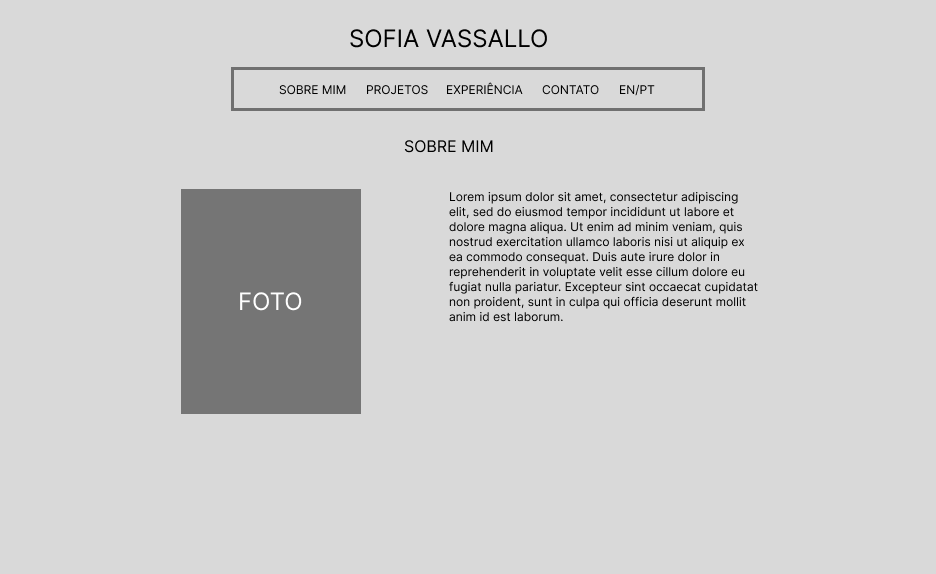
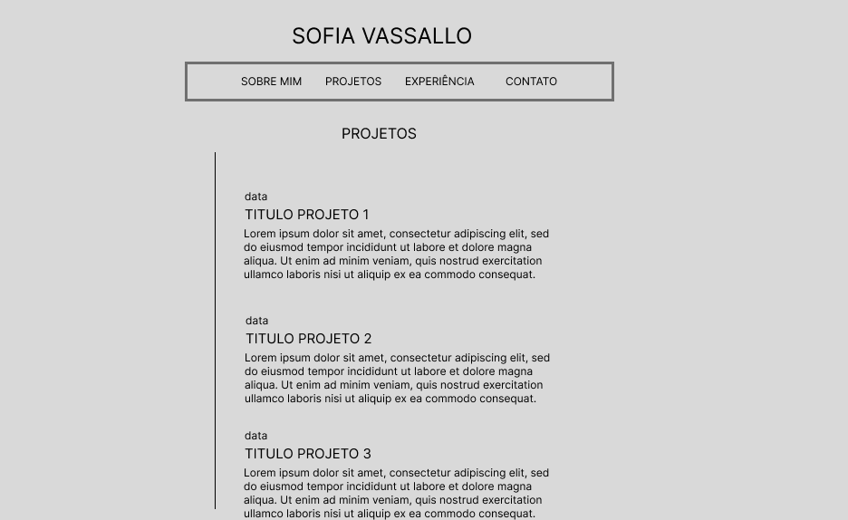
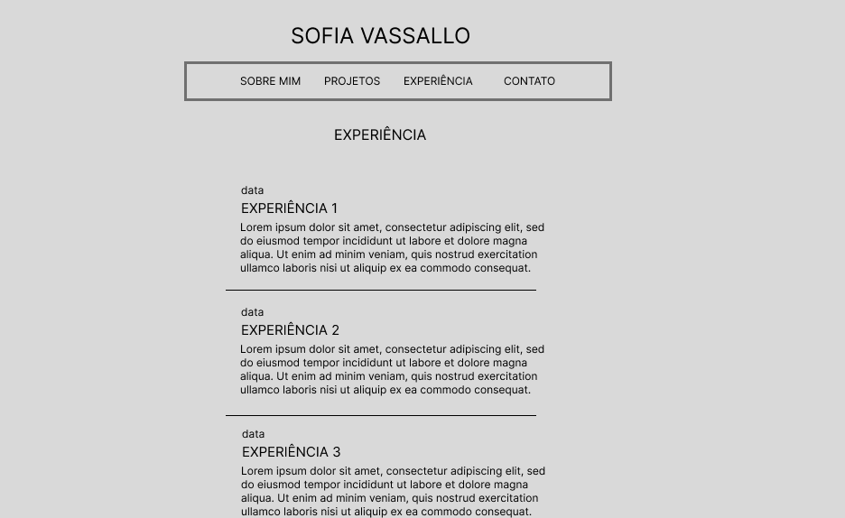
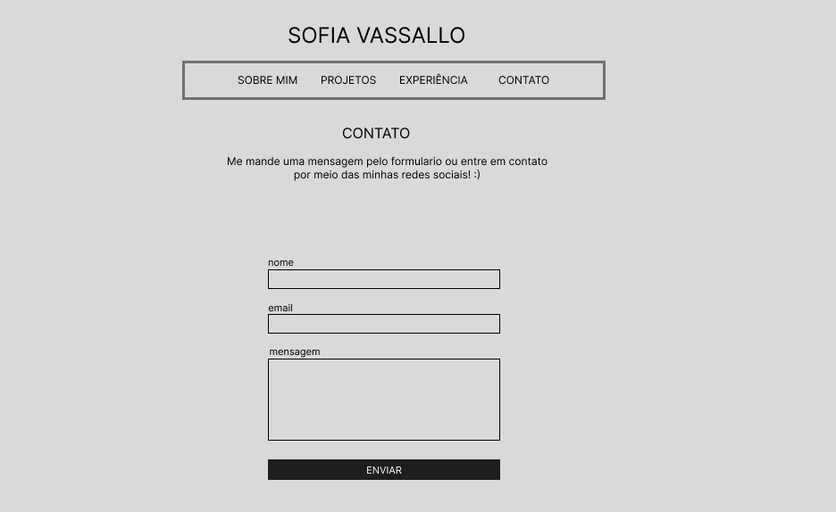

# 🏷️ Portfólio Profissional - Sofia Vassallo

Aplicação Web desenvolvida em **React + Vite** para apresentar minha trajetória acadêmica, projetos, experiências e formas de contato.

---

## 🔗 Links Úteis

* 🌐 **Demo Online:** [Acesse o Portfólio](https://portifolio-sofia-iota.vercel.app)
* 📦 **Repositório GitHub:** [GitHub - Sofia Vassallo](https://github.com/ofiaaaa/portifolio-sofia)

---

## ✨ Funcionalidades

* 🌐 **Suporte Multilingue:** Alternância entre Português e Inglês (PT/EN).
* 👤 **Sobre Mim:** Apresentação acadêmica e profissional.
* ⏳ **Projetos:** Exibição de projetos com links e tecnologias utilizadas.
* 💼 **Experiências:** Histórico profissional e trabalhos *freelance*.
* 📨 **Contato:** Formulário de mensagem e redes sociais.
* 📱 **Design Responsivo:** Adaptado para mobile e desktop.

---

## 🛠️ Tecnologias Utilizadas

* **Front-end:** React v18, Vite, JavaScript (ES6+), CSS3
* **Hospedagem:** Vercel
* **Versionamento:** Git & GitHub

---

## Wireframes






---

## 🚀 Como Executar o Projeto

1. **Clone o repositório:**
   ```bash
   git clone https://github.com/seu-usuario/meu-portfolio.git
   cd meu-portfolio
   ```

2. **Instale as dependências:**
   ```bash
   npm install
   ```

3. **Inicie o servidor local:**
   ```bash
   npm run dev
   ```
   Acesse em `http://localhost:5173`.

---

## 👥 Autora

* **Sofia Vassallo** — *Aluna de Engenharia de Software na PUC Minas*